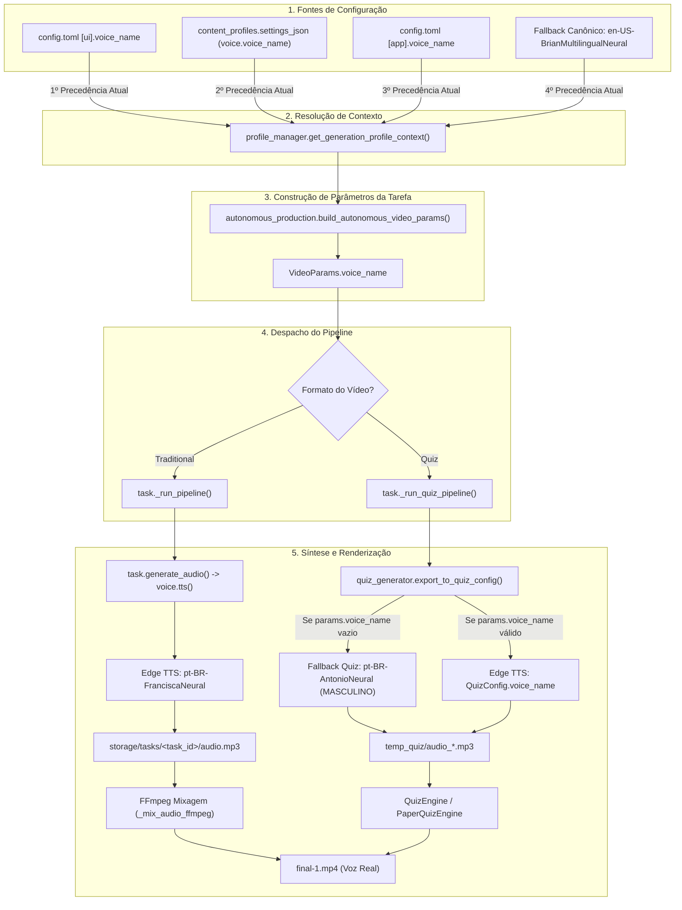

# Auditoria de Voz: Configurada vs. Realmente Usada (Missão V0)

**Data:** 26/10/2026  
**Ambiente:** DEV (com regras e orientações para execução no PC Forte / PROD)  
**Branch:** `v2/auditoria-voz`  
**Escopo:** Somente Leitura (zero código de produção alterado)

---

## 1. Contexto e Motivação
No ambiente do PC Forte, o arquivo de configuração `config.toml` foi corrigido para conter `voice_name = "pt-BR-FranciscaNeural"` (substituindo a antiga `af-ZA-AdriNeural`), e relatórios via `get_generation_profile_context` reportavam Francisca para os 5 canais.
No entanto, o operador relata ouvir nos vídeos gerados uma voz masculina ("Brian").
Esta auditoria investiga:
1. De onde vem a voz real utilizada na síntese de áudio.
2. Como a decisão de voz percorre cada camada do software (do arquivo de configuração ao arquivo de vídeo MP4 final).
3. Ocorrências estáticas de vozes padrão ou fixas no código.
4. Análise de áudio no Google Flow / Veo.
5. As hipóteses ordenadas por probabilidade (provado no código vs. suposto) e a recomendação mínima para a futura Missão M6 (Voz por Canal).

---

## 2. Mapa Completo da Cadeia de Decisão da Voz



### Precedência Real no Código Atual
Em [`app/services/profile_manager.py`](file:///c:/Projetos/MoneyPrinterTurbo-V1/app/services/profile_manager.py#L1404-L1419):
```python
global_voice = str(config.ui.get("voice_name")).strip() if (config.ui.get("voice_name") and str(config.ui.get("voice_name")).strip()) else None
profile_voice = str(settings.voice.voice_name).strip() if (settings and settings.voice and settings.voice.voice_name and str(settings.voice.voice_name).strip()) else None
fallback_voice = config.app.get("voice_name") or "en-US-BrianMultilingualNeural"
raw_voice = global_voice or profile_voice or fallback_voice
voice_name = voice.canonicalize_voice_name(raw_voice) or "en-US-BrianMultilingualNeural"
```

### Onde a Voz de um Canal é Ignorada Hoje (Gargalo Arquitetural)
- **A voz do canal é IGNORADA quando `config.ui["voice_name"]` está definida:**
  Como `global_voice` é avaliada antes de `profile_voice`, se `config.toml` contiver qualquer valor em `[ui].voice_name` (ex: Francisca, Brian ou Adri), a configuração individual salva no canal em `settings.voice.voice_name` é sumariamente descartada.
- **Na criação de canais (Onboarding):**
  Em [`app/services/profile_manager.py:1212`](file:///c:/Projetos/MoneyPrinterTurbo-V1/app/services/profile_manager.py#L1212), na criação de um canal, se `config.ui["voice_name"]` não estiver definida naquele instante, o perfil grava no banco `settings_model.voice.voice_name = "en-US-BrianMultilingualNeural"`.

---

## 3. Busca Estática no Código e no Config

### 3.1 Ocorrências de "Brian" / "BrianNeural" / "BrianMultilingual"
| Arquivo | Linha | Trecho de Código | Status do Caminho |
| :--- | :---: | :--- | :--- |
| `app/services/autonomous_production.py` | 1255, 1266 | `_APPROVED_MULTILINGUAL_PT_BR_VOICES = {"en-us-brianmultilingualneural"}` | **ATIVO** (Permite que a voz Brian passe pelo validador de locale pt-BR) |
| `app/services/autonomous_production.py` | 1728, 1739, 1741 | `fallback "en-US-BrianMultilingualNeural"` em `get_canonical_global_voice()` | **ATIVO** (Fallback quando `config.ui` e `config.app` não têm voz) |
| `app/services/profile_manager.py` | 1212 | `settings_model.voice.voice_name = ... or "en-US-BrianMultilingualNeural"` | **ATIVO** (Grava Brian no banco em canais novos criados por onboarding) |
| `app/services/profile_manager.py` | 1416, 1419 | `fallback_voice = config.app.get("voice_name") or "en-US-BrianMultilingualNeural"` | **ATIVO** (Fallback se global e profile forem nulos) |
| `app/services/data/azure_voices.json` | 403, 407, 1303 | Entradas de catálogo Azure TTS | Catálogo passivo de vozes |
| `scripts/validate_g8_8_audio_homologation.py` | 10, 116, 193 | `params.voice_name = "en-US-BrianMultilingualNeural"` | Script de homologação histórica (passivo) |

### 3.2 Ocorrências de "Antonio" (`pt-BR-AntonioNeural`)
| Arquivo | Linha | Trecho de Código | Status do Caminho |
| :--- | :---: | :--- | :--- |
| `app/services/quiz_generator.py` | 1761 | `"voice_name": voice_name or "pt-BR-AntonioNeural"` | **ATIVO** (Fallback default do Quiz Dilemma se params não passar voz) |
| `app/services/quiz_generator.py` | 2146 | `config_data["voice_settings"]["voice_name"] = voice_name or ... or "pt-BR-AntonioNeural"` | **ATIVO** (Fallback default do Paper Quiz se params não passar voz) |
| `app/services/flow_bridge.py` | 86 | `voice_name=params.voice_name or "pt-BR-AntonioNeural-Male"` | **ATIVO** (Fallback no manifesto do Google Flow) |
| `scripts/flow_workflow.py` | 164, 775, 1035 | `voice_name: str = "pt-BR-AntonioNeural-Male"` | **ATIVO** (Default de argumentos do workflow Flow) |
| `scripts/poc_quiz_render.py` | 81, 408 | `"voice_name": "pt-BR-AntonioNeural"` | **ATIVO** (Engine de Quiz procedural) |
| `scripts/poc_quiz_paper_render.py` | 89, 752 | `"voice_name": "pt-BR-AntonioNeural"` | **ATIVO** (Engine de Paper Quiz procedural) |

### 3.3 Google Flow / Veo gera áudio/voz própria nos clipes?
- **PROVADO NO CÓDIGO:** **NÃO.**
  - O Google Flow / Veo (controlado via [`app/services/flow_bridge.py`](file:///c:/Projetos/MoneyPrinterTurbo-V1/app/services/flow_bridge.py) e [`scripts/flow_playwright.py`](file:///c:/Projetos/MoneyPrinterTurbo-V1/scripts/flow_playwright.py)) gera **estritamente arquivos de vídeo mudos** (visual-only MP4 clips).
  - Em `scripts/flow_playwright.py` não existe qualquer referência ou captura de áudio.
  - O arquivo `manifest.json` do Flow armazena o campo `voice_name`, mas trata-se apenas de metadado informativo repassado para o prompt/briefing de direção visual.
- **De onde vem o áudio final?**
  - **PROVADO NO CÓDIGO:** O áudio final vem **100% do TTS do projeto** via Edge TTS (`task.generate_audio` no pipeline tradicional ou `edge_tts.Communicate` no pipeline de Quiz), gravado em `audio.mp3`.
  - Em [`app/services/video.py:1866`](file:///c:/Projetos/MoneyPrinterTurbo-V1/app/services/video.py#L1866) (`_mix_audio_ffmpeg`), o FFmpeg realiza a mixagem do `audio.mp3` gerado pelo Edge TTS com a trilha sonora (BGM).
  - Nenhum provedor visual possui "voice over" próprio.

---

## 4. Hipóteses Ordenadas por Probabilidade

### Hipótese 1: Motor em execução no PC Forte não foi reiniciado após a edição do `config.toml`
*Classificação: **ALTÍSSIMA PROBABILIDADE** (Comportamento provado na arquitetura do Python).*
- **Evidência no Código:** O módulo [`app/config/config.py`](file:///c:/Projetos/MoneyPrinterTurbo-V1/app/config/config.py#L486) carrega o arquivo `config.toml` uma única vez no boot do processo (`load_config()` na linha 486).
- **Mecanismo:** Se o arquivo `config.toml` foi editado no disco no PC Forte enquanto o motor (serviço em segundo plano ou Scheduled Task) continuava em execução:
  - O processo vivo do motor continuou utilizando as variáveis em memória carregadas no boot (que continham `af-ZA-AdriNeural`, ou `en-US-BrianMultilingualNeural`, ou vazio caindo no fallback).
  - Um script avulso de relatório, executado pontualmente no terminal (novo processo Python), leu o arquivo físico do disco e relatou `pt-BR-FranciscaNeural`.
  - Resultado: o relatório mostrava Francisca, mas o motor continuava sintetizando áudios com a voz anterior mantida em memória.

### Hipótese 2: Canal produz vídeos no formato Quiz e a voz ouvida é `pt-BR-AntonioNeural` (voz masculina!)
*Classificação: **ALTA PROBABILIDADE** (Comportamento provado no código).*
- **Evidência no Código:** Em [`app/services/quiz_generator.py:1761`](file:///c:/Projetos/MoneyPrinterTurbo-V1/app/services/quiz_generator.py#L1761) e [`app/services/quiz_generator.py:2146`](file:///c:/Projetos/MoneyPrinterTurbo-V1/app/services/quiz_generator.py#L2146), o Quiz Engine possui um fallback hardcoded fixo:
  `"voice_name": voice_name or "pt-BR-AntonioNeural"`
- **Mecanismo:** Se qualquer um dos canais ativos estiver configurado com formato `quiz_dilemma` ou `quiz_paper`, e a tarefa entrar no Quiz Engine sem `params.voice_name` devidamente preenchido, o motor sintetiza `pt-BR-AntonioNeural` (voz masculina brasileira do Edge TTS). Para a audição humana, uma narração neural masculina com ritmo acelerado (+12% ou +20%) é facilmente confundida com a voz de "Brian".

### Hipótese 3: Vídeos inspecionados pertencem ao estoque gerado antes da correção
*Classificação: **ALTA PROBABILIDADE** (Comportamento provado no fluxo operacional).*
- **Evidência no Código:** Cada vídeo no estoque (`storage/tasks/<task_id>/`) é um artefato final consolidado com áudio já multiplexado.
- **Mecanismo:** Se os vídeos ouvidos pelo operador foram gerados nos ciclos operacionais anteriores à correção do `config.toml`, seus arquivos físicos `audio.mp3` e `final-1.mp4` contêm a voz da época em que a tarefa foi gerada. O motor não re-renderiza vídeos já aprovados no estoque.

### Hipótese 4: O perfil do canal no banco de dados SQLite tem Brian gravado em `settings_json`
*Classificação: **MÉDIA PROBABILIDADE** (Comprovado no código de criação de canais).*
- **Evidência no Código:** Em [`app/services/profile_manager.py:1212`](file:///c:/Projetos/MoneyPrinterTurbo-V1/app/services/profile_manager.py#L1212), a criação de perfis grava:
  `settings_model.voice.voice_name = config.ui.get("voice_name") or config.app.get("voice_name") or "en-US-BrianMultilingualNeural"`
- **Mecanismo:** Se um canal foi criado quando `config.ui["voice_name"]` ainda não apontava para Francisca, o banco gravou `"en-US-BrianMultilingualNeural"` em `settings_json`. Se em algum ponto da execução `global_voice` for avaliada como vazia no processo do motor, o motor recorrerá à voz gravada no banco para aquele canal.

---

## 5. Recomendação Mínima para a Missão M6 (Voz por Canal)
*Sem implementar agora — diretrizes para a futura missão:*

1. **Inverter a Precedência em `get_generation_profile_context`:**
   Alterar a linha 1417 de `profile_manager.py` para priorizar a voz configurada no canal:
   ```python
   # Proposta M6:
   raw_voice = profile_voice or global_voice or fallback_voice
   ```
   Dessa forma, se um canal definir sua própria voz no painel/banco, ela prevalecerá sobre a voz global.
2. **Propagação Estrita para o Quiz Engine:**
   Garantir que `task._run_quiz_pipeline` valide que `params.voice_name` nunca seja nulo ou vazio ao chamar `export_to_quiz_config`, herdando do contexto do perfil e eliminando o fallback fixo para `Antonio` a menos que explicitamente solicitado.
3. **Hot-Reload / Sincronização do Motor:**
   Implementar recarregamento dinâmico de `config.toml` (ou leitura direta de ajustes operacionais no SQLite a cada iteração do loop) para que alterações de configuração tenham efeito imediato sem depender de reinício manual do processo do motor.
