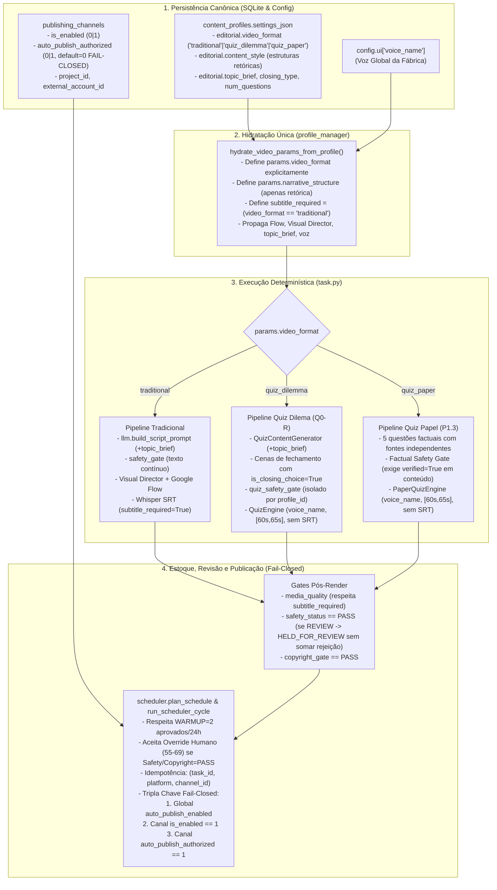

# CONSOLIDAÇÃO ARQUITETURAL V1 — REORGANIZAÇÃO ESTRUTURAL (AJUSTE FINAL)

**Projeto:** `C:\Projetos\MoneyPrinterTurbo-V1`  
**Fase / Gate Vigente:** `V1.5E` / `V1_CONTROLLED_QUIZ_SAFETY_GATE_PACKAGE_PREPARED`  
**Branch Auditada:** `fix/v1-quiz-safety-gate` (HEAD: `1c49249` + modificações locais de roteamento)  
**Quadro Trello Referência:** `Video Factory V1 | Reorganização Estrutural` (`https://trello.com/b/0ewihckV/video-factory-v1-reorganiza%C3%A7%C3%A3o-estrutural`)  
**Princípio Arquitetural Obrigatório:** Eliminar responsabilidades duplicadas na raiz; remover heurísticas antigas ao consolidar contratos; zero novas camadas de remendos ou falsificações de flags de segurança.

---

## 1. MATRIZ DE FONTES DE VERDADE (SINGLE SOURCE OF TRUTH)

Cada domínio operacional possui **uma única fonte primária persistida** e **um único contrato de transporte em tempo de execução**, eliminando inferências tardias e heurísticas espalhadas:

| Domínio / Responsabilidade | Fonte de Verdade Persistida (Banco / Config) | Provedor / Hidratador Canônico | Contrato em Runtime | Consumidores Finais (Somente Leitura do Contrato) |
|---|---|---|---|---|
| **Formato do Vídeo (Motor / Pipeline)** | `content_profiles.settings_json` (`editorial.video_format`: `"traditional"`, `"quiz_dilemma"`, `"quiz_paper"`) | `profile_manager.get_generation_profile_context()` | `VideoParams.video_format` | `task._run_pipeline` (roteamento de motor), `quiz_safety_gate`, `media_quality` (isenção de SRT para Quiz) |
| **Estrutura Narrativa (Retórica do Roteiro)** | `content_profiles.settings_json` (`editorial.content_style` ou rotação autônoma: `"investigative_mystery"`, `"explainer"`, `"fact_context"`, `"myth_vs_reality"`, `"short_story"`) | `webui_task.submit_generation` / `build_autonomous_video_params` | `VideoParams.narrative_structure` | `llm.build_script_prompt`, `safety_gate.evaluate_script_safety` (exclusivo para `video_format == "traditional"`) |
| **Diretriz Temática (`topic_brief`)** | `content_profiles.settings_json` (`editorial.topic_brief`) | `profile_manager.get_generation_profile_context()` | `VideoParams.topic_brief` | `autopilot.build_ideas_prompt`, `llm.build_script_prompt`, `quiz_generator` |
| **Encerramento e Nº de Questões (`closing_type`, `num_questions`)** | `content_profiles.settings_json` (`editorial.closing_type`, `editorial.num_questions`) | `profile_manager.get_generation_profile_context()` | `VideoParams.closing_type`, `VideoParams.num_questions` | `task._run_quiz_pipeline`, `quiz_generator._apply_channel_closing` |
| **Voz da Fábrica (`voice_name`, `voice_rate`)** | `config.ui["voice_name"]` (Voz Global da Fábrica) $\succ$ `settings.voice.voice_name` | `profile_manager.get_generation_profile_context()` | `VideoParams.voice_name`, `VideoParams.voice_rate` | `voice.tts` (Tradicional), `QuizEngine` (+12%), `PaperQuizEngine` (+20%) |
| **Direção Visual & Google Flow** (`flow_enabled`, `visual_director_enabled`, `visual_style_brief`, `flow_scene_count`) | `content_profiles.settings_json` (`visual.*`) | `profile_manager.get_generation_profile_context()` | `VideoParams.flow_enabled`, `visual_director_enabled`, `visual_style_brief` | `task._run_pipeline` (exclusivo quando `video_format == "traditional"`) |
| **Exigência de Artefato SRT (`subtitle_required`)** | Derivado deterministicamente de `VideoParams.video_format` | Hidratação de `VideoParams` | `VideoParams.subtitle_required` (`False` se `video_format` for Quiz; `True` se `traditional` autônomo) | `media_quality.evaluate_final_media_quality` |
| **Faixa Editorial de Duração (Quiz)** | Constante canônica `[60.0s, 65.0s]` (Padrões Q0-R / P1.3) | `QuizConfig` / `PaperQuizConfig` | `target_duration_range = (60.0, 65.0)` | `task._run_quiz_pipeline`, `quiz_safety_gate.evaluate_quiz_duration_safety` |
| **Classificação de Encerramento vs Factual Gate** | `question["is_closing_choice"]` (booleano estrutural do item de fechamento) vs `question["verified"]` (comprovação de fonte científica independente) | `quiz_generator._apply_channel_closing` | `q["is_closing_choice"] = True` (cenas de fechamento não são perguntas factuais; jamais falsificar `verified=True`) | `quiz_safety_gate.extract_quiz_dilemmas` (exclui da similaridade), `task._run_quiz_pipeline` (`factual_gate` avalia apenas perguntas de conteúdo `not q.get("is_closing_choice")`) |
| **Autorização de Publicação Automática por Canal** | Contrato Fail-Closed de 3 Chaves: 1) `autopilot_settings.auto_publish_enabled == "true"` AND 2) `publishing_channels.is_enabled == 1` AND 3) `publishing_channels.auto_publish_authorized == 1` (default `0` / `False`) | `scheduler.is_channel_auto_publish_authorized(channel_id, profile_id)` | Booleano determinístico **Fail-Closed** (nenhum canal publica automaticamente sem habilitação explícita individual) | `scheduler.plan_schedule`, `scheduler.run_scheduler_cycle` |
| **Idempotência de Publicação** | `publication_events` (`status='success'`) + `scheduled_posts` (`idx_active_schedule_v2`) | `publishing_idempotency` | Tupla canônica `(task_id, platform, COALESCE(channel_id, ''))` | `scheduler`, `task.publish_task`, `youtube_publisher`, `post_for_me` |
| **Qualidade, Revisão e Limites Operacionais (`WARMUP`, `REVIEW`, Override Humano)** | `content_profiles.growth_mode`, `content_quality_scores`, `operator_video_reviews` | `autonomous_production`, `quality_recovery`, `scheduler` | Governado por decisão explícita de regra de negócio (Seção 2.3) | `autonomous_production`, `scheduler.plan_schedule` |

---

## 2. CLASSIFICAÇÃO RIGOROSA: DEFEITOS COMPROVADOS vs MUDANÇAS DE REGRA DE NEGÓCIO

Para evitar alterações não autorizadas na semântica operacional da fábrica, os 14 pontos levantados pelos Agentes 1, 2 e 3 foram separados entre **Correções de Defeitos Técnicos Comprovados** (quebras de contrato, bugs de implementação e violações de segurança) e **Mudanças Deliberadas em Regras de Negócio** (que exigem decisão explícita do operador antes de implementação).

### 2.1 Defisito Estrutural 1: Separação Limpa entre `video_format` e `narrative_structure` (Eliminação de Heurísticas)
- **Problema Comprovado:** `video_format` (formato de produção/motor: `traditional`, `quiz_dilemma`, `quiz_paper`) estava sobrecarregando `VideoParams.narrative_structure` (estrutura retórica do texto: `investigative_mystery`, `explainer`, etc.). Como consequência, [`webui/Main.py:5280`](file:///c:/Projetos/MoneyPrinterTurbo-V1/webui/Main.py#L5280) descartava `"traditional"`, [`task.py:3229-3248`](file:///c:/Projetos/MoneyPrinterTurbo-V1/app/services/task.py#L3229-L3248) fazia consultas tardias ao SQLite com `startswith("quiz")` e [`quiz_safety_gate.py:56-135`](file:///c:/Projetos/MoneyPrinterTurbo-V1/app/services/quiz_safety_gate.py#L56-L135) precisava adivinhar o formato a partir de dezenas de strings.
- **Solução Definitiva e Migração de Consumidores (Sem Heurísticas Concorrentes):**
  1. **Definição Explícita:**
     - `VideoParams.video_format`: Literal canônico obrigatório na hidratação (`"traditional"`, `"quiz_dilemma"`, `"quiz_paper"`). Define **qual pipeline, qual renderizador e qual Safety Gate** serão executados.
     - `VideoParams.narrative_structure`: Exclusivo para a **estrutura retórica do roteiro tradicional** (`"investigative_mystery"`, `"explainer"`, `"fact_context"`, `"myth_vs_reality"`, `"short_story"`). Quando `video_format != "traditional"`, `narrative_structure` não é usado para rotear pipeline.
  2. **Mapa de Migração de Consumidores (Remoção de Fallbacks Antigos):**
     - `profile_manager.get_generation_profile_context`: normaliza qualquer legado onde `quiz_*` tenha sido salvo em `content_style` ou `narrative_structure`, entregando `ctx["video_format"]` limpo (`"traditional" | "quiz_dilemma" | "quiz_paper"`) e `ctx["narrative_structure"]` apenas para estruturas retóricas.
     - `webui_task.submit_generation` e `autonomous_production.build_autonomous_video_params`: hidratam `params.video_format` e `params.narrative_structure` na entrada.
     - `task._run_pipeline`: roteia **unicamente** por `if params.video_format in ("quiz_dilemma", "quiz_paper"): return _run_quiz_pipeline(...)`. Remove-se a consulta tardia ao banco em `task.py:3220-3239` e o `startswith("quiz")`.
     - `quiz_safety_gate.is_quiz_dilemma`: verifica diretamente `params.video_format == "quiz_dilemma"`, eliminando adivinhações léxicas.
     - `const.NARRATIVE_STRUCTURES`: volta a conter apenas estruturas retóricas de roteiro tradicional; a escolha de formato de vídeo na UI lê/escreve `video_format`.

### 2.2 Outros Defeitos Técnicos Comprovados (Correção Obrigatória)
1. **Classificação Editorial da Cena Religiosa (Proibido `verified=True` Artificial):**
   - **Evidência:** Em [`quiz_generator.py:433-454`](file:///c:/Projetos/MoneyPrinterTurbo-V1/app/services/quiz_generator.py#L433-L454), quando `closing_type == "quiz_choice_religious"`, a penúltima pergunta (`questions[-2]`: *"Ficar dois dias sem internet... Ou curtir e comentar: Jesus te ama?"*) é um card de **encerramento editorial de engajamento** (padrão Q0-R Item E), e não uma questão factual/científica nem um dilema temático do vídeo. Porém, como apenas `questions[-1]` recebia `is_closing_choice = True` (linha 457), `questions[-2]` era tratada como pergunta comum pelo `quiz_safety_gate` (inflando similaridade entre vídeos) e pelo `factual_gate` ([`task.py:2858`](file:///c:/Projetos/MoneyPrinterTurbo-V1/app/services/task.py#L2858)).
   - **Correção Estrita:** Marcar `penult_q["is_closing_choice"] = True` e `penult_q["role"] = "editorial_closing"` em `_apply_channel_closing`. **JAMAIS atribuir `verified = True` a cenas de fechamento.** O `factual_gate` ([`task.py:2856-2860`](file:///c:/Projetos/MoneyPrinterTurbo-V1/app/services/task.py#L2856-L2860)) permanece 100% rigoroso: exige `verified == True` com fonte independente para todas as perguntas de conteúdo (`not q.get("is_closing_choice")`), e valida que pelo menos 1 pergunta factual real verificada exista no quiz antes de aprovar.
   - **Descontaminação do Fallback:** Em [`quiz_generator.py:821-841`](file:///c:/Projetos/MoneyPrinterTurbo-V1/app/services/quiz_generator.py#L821-L841), substituir a pergunta `q7` estática religiosa do `_generate_fallback_content` por um dilema secular neutro; a cena religiosa só existirá quando `_apply_channel_closing` for chamado com `closing_type == "quiz_choice_religious"`.
2. **Autorização Individual de Publicação Automática por Canal (Prioridade Fail-Closed):**
   - **Evidência:** [`scheduler.py:1719`](file:///c:/Projetos/MoneyPrinterTurbo-V1/app/services/scheduler.py#L1719) verifica apenas `auto_publish_enabled` global e `publishing_channels.is_enabled == 1`. Ativar o `auto_publish_enabled` global liberaria publicação automática em qualquer canal com conta conectada, inclusive canais criados apenas para acumular estoque.
   - **Correção Estrita (Fail-Closed):** Adicionar coluna/atributo `auto_publish_authorized INTEGER DEFAULT 0` em `publishing_channels` (e espelho em `ChannelWorkspaceSettings.automation.auto_publish_authorized: bool = False`). **Por padrão, nenhum canal (novo ou existente) tem publicação automática liberada (`0` / `False`)** até que seja explicitamente autorizado individualmente pelo operador.
3. **Hidratação Incompleta em `webui_task.submit_generation`:**
   - **Evidência:** [`webui_task.py:165-188`](file:///c:/Projetos/MoneyPrinterTurbo-V1/app/services/webui_task.py#L165-L188) perde `flow_enabled`, `visual_director_enabled`, `visual_style_brief`, `flow_scene_count`, `topic_brief`, `closing_type` e `num_questions` na geração manual.
   - **Correção:** Hidratar todos os campos não informados explicitamente a partir de `get_generation_profile_context`.
4. **Omissão de `topic_brief` no Gerador de Roteiro:**
   - **Evidência:** [`task.py:322-330`](file:///c:/Projetos/MoneyPrinterTurbo-V1/app/services/task.py#L322-L330), [`llm.py:700-786`](file:///c:/Projetos/MoneyPrinterTurbo-V1/app/services/llm.py#L700-L786) e [`quiz_generator.py`](file:///c:/Projetos/MoneyPrinterTurbo-V1/app/services/quiz_generator.py) ignoram `params.topic_brief`.
   - **Correção:** Passar `topic_brief` para `llm.build_script_prompt` e `QuizContentGenerator`.
5. **Falso-Bloqueio de Media Quality por Falta de `.srt` no Quiz:**
   - **Evidência:** [`autonomous_production.py:1812`](file:///c:/Projetos/MoneyPrinterTurbo-V1/app/services/autonomous_production.py#L1812) fixa `subtitle_required=True`, fazendo [`media_quality.py:420-422`](file:///c:/Projetos/MoneyPrinterTurbo-V1/app/services/media_quality.py#L420-L422) reprovar vídeos de Quiz (que renderizam cards via Pillow sem arquivo `.srt`).
   - **Correção:** Na hidratação de `VideoParams`, definir `subtitle_required = False` e `subtitle_enabled = False` quando `video_format in ("quiz_dilemma", "quiz_paper")`.
6. **Voz Fixa e Janela de Duração Divergente no Quiz Dilema:**
   - **Evidência:** [`quiz_generator.py:914,924`](file:///c:/Projetos/MoneyPrinterTurbo-V1/app/services/quiz_generator.py#L914) fixa `"pt-BR-AntonioNeural"` e `target_duration_range = [62.0, 66.0]`, colidindo com a voz do canal e com o gate `[60.0, 65.0]` de [`task.py:2983`](file:///c:/Projetos/MoneyPrinterTurbo-V1/app/services/task.py#L2983).
   - **Correção:** Receber `voice_name` em `export_to_quiz_config` e unificar `target_duration_range = [60.0, 65.0]`.
7. **Literal `closing_type="comments"` e `num_questions` no Quiz Papel:**
   - **Evidência:** [`channel_factory.py:636`](file:///c:/Projetos/MoneyPrinterTurbo-V1/webui/components/channel_factory.py#L636) grava `"comments"` e `5`, mas `quiz_generator.py` espera `"score_challenge"` e `profile_manager.py:1448` assume default `8` (e `task.py:2755` assume `10`).
   - **Correção:** Padronizar `"score_challenge"` (aceitando `"comments"` como sinônimo de encerramento de pontuação) e default de `5` perguntas quando `video_format == "quiz_paper"` (padrão P1.3 homologado).
8. **Escopo de Canal em `publishing_idempotency.py`:**
   - **Evidência:** [`publishing_idempotency.py:48,99,282`](file:///c:/Projetos/MoneyPrinterTurbo-V1/app/services/publishing_idempotency.py#L48) filtra apenas `(task_id, platform)`, divergindo do índice `idx_active_schedule_v2` `(task_id, COALESCE(channel_id, ''), platform)`.
   - **Correção:** Incluir `channel_id` nas consultas de idempotência.

---

### 2.3 Mudanças Deliberadas em Regras de Negócio (APROVADAS PELO OPERADOR)

As 3 decisões de governança operacional foram **explicitamente decididas e aprovadas** pelo operador humano para execução no **Lote 3B**:

| ID | Regra de Negócio | Decisão Humana Aprovada (Canônica) | Ação de Implementação (Lote 3B) |
|---|---|---|---|
| **RN-01** | **Teto Diário de Aprovações em `WARMUP`** (`autonomous_production.py:348`) | **APROVADO:** `WARMUP = 2` vídeos aprovados por canal na janela móvel de 24 horas (e `SCALE = 5`). | Alterar `mode_cap = 2` no ramo `gm == const.GROWTH_MODE_WARMUP` em `get_max_generations_24h()`. |
| **RN-02** | **Soberania da Aprovação Humana (Score 55–69) no Scheduler** (`scheduler.py:1165-1180`) | **APROVADO:** Aprovação humana (`operator_video_reviews.decision == 'APPROVED'`) libera o agendamento de vídeos na faixa 55–69, **exclusivamente se todos os gates técnicos e de segurança (`Safety == PASS`, `Copyright == PASS`, MP4 íntegro) estiverem `PASS`**. | Em `scheduler.plan_schedule`, permitir tarefas com `55.0 <= q_score < 70.0` (ou `q_label == 'REVIEW'`) somente quando houver registro `decision = 'APPROVED'` em `operator_video_reviews` e `Safety`/`Copyright` forem estritamente `PASS`. |
| **RN-03** | **Retenção de Vídeos em `REVIEW` sem Penalizar Rejeições Definitivas** (`task.py:3071`, `autonomous_production.py:1505,2391`) | **APROVADO:** Vídeos em `REVIEW` ficam retidos para revisão humana (`HELD_FOR_REVIEW`), **sem publicação automática e sem incrementar o contador de rejeições definitivas (`consecutive_rejections`)**. | 1) Em `task.py`, se `safety_status == 'REVIEW'`, não promover a `READY_STOCK` (`stage = 'HELD_SAFETY_REVIEW'`). 2) Em `autonomous_production.py`, quando a tarefa for retida por `REVIEW` (candidata à revisão humana), transicionar sem incrementar `consecutive_rejections`. |

---

## 3. ARQUITETURA-ALVO E CONTRATOS ENTRE CAMADAS

---

## 4. MATRIZ DE LOTES DE IMPLEMENTAÇÃO

| LOTE | AGENTE | ARQUIVOS | DEPENDÊNCIAS | TESTES | RISCO |
|---|---|---|---|---|---|
| **ETAPA 0A — CONCLUÍDA** *(Pré-Requisito Obrigatório: Reconciliação Física SHA-256 DEV $\leftrightarrow$ PC Forte)* | **Arquiteto + Operador** | `docs/auditorias/inventario_dev_v1.json` `docs/auditorias/inventario_prod_pc_forte.json` | **Concluída e aprovada.** 443 arquivos idênticos; 3 divergências reconciliadas byte a byte (DEV já é superconjunto dos hotfixes instalados no PC Forte). | Comparação determinística de manifestos JSON (`path`, `sha256`, `size`). | **Concluído** |
| **LOTE 0** *(Congelamento do Baseline Reconciliado e Criação de Worktrees)* | **Arquiteto / Agente 2** | `app/services/quiz_safety_gate.py` `app/services/task.py` `test/services/test_quiz_safety_routing.py` | Depende da conclusão da **ETAPA 0A**. Preserva hotfixes reconciliados em commit de baseline e cria as 2 worktrees isoladas. | `.\.venv\Scripts\python.exe -m pytest test/services/test_quiz_safety_routing.py -q -p no:cacheprovider` | **Baixo** |
| **LOTE 1** *(Contratos, Hidratação e Separação `video_format` vs `narrative_structure`)* | **Agente 1** *(Configurações e Contratos)* | `app/models/schema.py` `app/models/const.py` `app/services/profile_manager.py` `app/services/webui_task.py` `app/services/llm.py` `test/services/test_channel_factory.py` | Depende de **ETAPA 0A + LOTE 0**. Antecede obrigatoriamente o **LOTE 2**. | `.\.venv\Scripts\python.exe -m pytest test/services/test_channel_factory.py -k "hydration or video_format or brief" -q -p no:cacheprovider` | **Médio** (Altera contrato base `VideoParams` e hidratação manual) |
| **LOTE 2** *(Pipeline Quiz, Classificação de Encerramento, Isenção SRT, Voz e Duração)* | **Agente 2** *(Pipeline e Qualidade)* | `app/services/task.py` `app/services/quiz_generator.py` `app/services/quiz_safety_gate.py` `scripts/poc_quiz_render.py` `test/services/test_quiz_integration.py` | Depende estritamente da conclusão do **LOTE 1** (consome `params.video_format`, `subtitle_required` e `topic_brief`). | `.\.venv\Scripts\python.exe -m pytest test/services/test_quiz_integration.py -q -p no:cacheprovider` | **Médio** (Toca roteamento em `task.py` e regras de fechamento do Quiz) |
| **LOTE 3A** *(Autorização Fail-Closed por Canal e Idempotência Multicanal — Defeitos Comprovados)* | **Agente 3** *(Operação e Publicação)* | `app/services/scheduler.py` `app/services/publishing_idempotency.py` `test/services/test_scheduler.py` | Depende de **ETAPA 0A + LOTE 0**. **Zero arquivos compartilhados** com Lotes 1 e 2. | `.\.venv\Scripts\python.exe -m pytest test/services/test_scheduler.py -k "channel_auth or idempotency" -q -p no:cacheprovider` | **Baixo / Médio** (Política fail-closed protege contra publicação acidental) |
| **LOTE 3B** *(Regras de Negócio Aprovadas: `WARMUP=2`, Override `REVIEW` 55–69 e Retenção sem Rejeição)* | **Agente 3** *(Operação e Publicação)* | `app/services/autonomous_production.py` `app/services/scheduler.py` `test/services/test_autonomous_production.py` | Regras `RN-01..03` já aprovadas. Depende tecnicamente da conclusão de **LOTE 1** e **LOTE 3A**. | `.\.venv\Scripts\python.exe -m pytest test/services/test_autonomous_production.py -k "warmup or review" -q -p no:cacheprovider` | **Médio** (Altera limites operacionais e critérios de agendamento) |
| **LOTE 4** *(Sincronização da UI Legada Streamlit)* | **Agente 1 / Agente 3** | `webui/Main.py` `webui/components/channel_factory.py` | Depende da conclusão de **LOTE 1, LOTE 2, LOTE 3A e LOTE 3B**. | `.\.venv\Scripts\python.exe -m pytest test/services/test_channel_factory.py -k "ui or format" -q -p no:cacheprovider` | **Baixo** |

---

## 5. REGRAS DE EXECUÇÃO SIMULTÂNEA (PARALELISMO PERMITIDO E BLOQUEIOS)

### O que PODE ser executado simultaneamente:
- **Par Único de Paralelismo Real:** **LOTE 1 (Agente 1)** e **LOTE 3A (Agente 3)** podem ser implementados simultaneamente **somente se executados em worktrees Git isolados** (`git worktree`), pois seus conjuntos de arquivos são 100% disjuntos:
  - *Worktree Agente 1 (Lote 1):* `app/models/schema.py`, `app/models/const.py`, `app/services/profile_manager.py`, `app/services/webui_task.py`, `app/services/llm.py`.
  - *Worktree Agente 3 (Lote 3A):* `app/services/scheduler.py` (adição da coluna/checagem `auto_publish_authorized` em `publishing_channels`), `app/services/publishing_idempotency.py`.
  - *Regra de Fronteira para manter isolamento:* No Lote 3A, a coluna `auto_publish_authorized` é criada na tabela `publishing_channels` via migração aditiva em `scheduler.init_db()`, sem tocar em `profile_manager.py` até a junção com o Lote 1.

### O que NÃO PODE ser executado simultaneamente (Sequenciamento Obrigatório):
1. **LOTE 2 (Agente 2) NUNCA roda em paralelo com LOTE 1:** O Lote 2 refatora `task.py` e `quiz_safety_gate.py` para remover heurísticas e ler `params.video_format`, `params.subtitle_required` e `params.topic_brief` introduzidos pelo Lote 1.
2. **LOTE 3B NUNCA inicia sem decisão humana prévia sobre RN-01, RN-02 e RN-03:** Mudanças em `WARMUP`, override de `REVIEW` e Circuit Breaker exigem aprovação explícita da regra de negócio e tocam `autonomous_production.py` (que também consome o contrato de `VideoParams` do Lote 1).
3. **LOTE 4 (UI Streamlit) é estritamente final:** Só inicia após merge de Lotes 1, 2 e 3A.

---

## 6. GATES DE TESTES INTEGRADOS PONTA A PONTA (POR FLUXO)

Respeitando a **TEST POLICY** (`AGENTS.md`: *1 comando direcionado por gate; se passar, PARAR; sem regressão completa sem autorização humana*), a validação integrada pós-implementação é composta por **5 Gates Funcionais End-to-End** (com mocks determinísticos de provedores externos, zero gasto de cota/GPU e zero publicação real):

1. **Gate Integrado 1 — Fluxo Manual (WebUI $\rightarrow$ `submit_generation` $\rightarrow$ Contrato):**
   - *Critério de Aceite:* Submissão manual para um perfil com `flow_enabled=True`, `visual_director_enabled=True`, `visual_style_brief` e `topic_brief` preserva 100% dos atributos em `VideoParams` até `task._run_pipeline`, sem cair em defaults vazios.
   - *Comando Direcionado:* `.\.venv\Scripts\python.exe -m pytest test/services/test_channel_factory.py -k "manual_submission_hydration" -q -p no:cacheprovider`
2. **Gate Integrado 2 — Fluxo Tradicional (`video_format="traditional"`):**
   - *Critério de Aceite:* `video_format="traditional"` preserva a subestrutura retórica (`narrative_structure="investigative_mystery"`), injeta `topic_brief` em `llm.build_script_prompt`, executa o `safety_gate` tradicional de texto linear e mantém `subtitle_required=True` no `media_quality`.
   - *Comando Direcionado:* `.\.venv\Scripts\python.exe -m pytest test/services/test_quiz_safety_routing.py -k "traditional_flow_contract" -q -p no:cacheprovider`
3. **Gate Integrado 3 — Fluxo Quiz Dilema (`video_format="quiz_dilemma"` / Padrão Q0-R):**
   - *Critério de Aceite:* Roteamento direto para `_run_quiz_pipeline` via `video_format="quiz_dilemma"`, bypass absoluto do Google Flow, cena religiosa (`questions[-2]`) e CTA final (`questions[-1]`) marcados com `is_closing_choice=True` (sem inflar similaridade em `quiz_safety_gate` e sem `verified=True` falso), voz do contrato repassada ao `QuizConfig`, duração validada em `[60.0s, 65.0s]` e aprovação em `media_quality` com `subtitle_required=False` (sem arquivo `.srt`).
   - *Comando Direcionado:* `.\.venv\Scripts\python.exe -m pytest test/services/test_quiz_safety_routing.py -k "quiz_dilemma_e2e_contract" -q -p no:cacheprovider`
4. **Gate Integrado 4 — Fluxo Quiz Papel (`video_format="quiz_paper"` / Padrão P1.3):**
   - *Critério de Aceite:* `num_questions=5`, `closing_type="score_challenge"` (compatível com `"comments"`), `factual_gate` bloqueando estritamente qualquer pergunta de conteúdo (`not is_closing_choice`) sem `verified=True` + fonte independente, e aprovando quando as 5 perguntas de conteúdo possuem fontes verificadas, com `subtitle_required=False`.
   - *Comando Direcionado:* `.\.venv\Scripts\python.exe -m pytest test/services/test_p3_quiz_multi_dest.py -k "paper_quiz_factual_and_closing" -q -p no:cacheprovider`
5. **Gate Integrado 5 — Fluxo Autônomo e Publicação Fail-Closed por Canal:**
   - *Critério de Aceite:* `build_autonomous_video_params` hidrata `video_format` e `subtitle_required` corretamente; `publishing_idempotency` isola agendamentos por `(task_id, platform, channel_id)`; e `scheduler.run_scheduler_cycle` bloqueia publicação automática se `auto_publish_authorized == 0` no canal (mesmo com `auto_publish_enabled` global `True` e `is_enabled == 1`), liberando somente para o canal explicitamente autorizado.
   - *Comando Direcionado:* `.\.venv\Scripts\python.exe -m pytest test/services/test_scheduler.py -k "per_channel_auto_publish_fail_closed" -q -p no:cacheprovider`

---

## 7. RECONCILIAÇÃO DEV $\leftrightarrow$ PC FORTE (ETAPA 0A OBRIGATÓRIA), MIGRAÇÃO E ROLLBACK

### 7.0 ETAPA 0A — Reconciliação Física DEV $\leftrightarrow$ PC Forte via SHA-256 (**CONCLUÍDA**)
A comparação física por SHA-256 entre [`docs/auditorias/inventario_dev_v1.json`](file:///c:/Projetos/MoneyPrinterTurbo-V1/docs/auditorias/inventario_dev_v1.json) (`452` arquivos em `C:\Projetos\MoneyPrinterTurbo-V1`, branch `fix/v1-quiz-safety-gate`, HEAD `1c49249` + working tree) e [`docs/auditorias/inventario_prod_pc_forte.json`](file:///c:/Projetos/MoneyPrinterTurbo-V1/docs/auditorias/inventario_prod_pc_forte.json) (`451` arquivos em `C:\Projetos\MoneyPrinterTurbo`, branch `main`, HEAD `cf7d647` + hotfixes locais) foi concluída e matematicamente comprovada byte a byte:

1. **Resumo Quantitativo da Comparação SHA-256:**
   - **443 arquivos 100% idênticos** entre DEV e Produção (incluindo todos os módulos de contrato, gates, scheduler, perfis e os 2 arquivos modificados no working tree do DEV: [`app/services/task.py`](file:///c:/Projetos/MoneyPrinterTurbo-V1/app/services/task.py) e [`app/services/quiz_safety_gate.py`](file:///c:/Projetos/MoneyPrinterTurbo-V1/app/services/quiz_safety_gate.py)).
   - **3 arquivos com conteúdo divergente** entre DEV e Produção (todos reconciliados por prova criptográfica contra o histórico Git sem necessidade de cópia manual da produção).
   - **6 arquivos exclusivos do DEV:** 4 relatórios de auditoria em `docs/auditorias/` (`agente_1_configuracoes.md`, `agente_2_pipeline.md`, `agente_3_operacao.md`, `consolidacao_arquiteto.md`) e 2 suítes de testes do Quiz Safety Gate (`test/services/test_quiz_safety_gate.py` e `test/services/test_quiz_safety_routing.py`).
   - **5 arquivos exclusivos da Produção:** 2 backups locais (`app/services/autonomous_production.py.bak_20261018_110834` e `config.toml.bak`) e 3 artefatos compilados da Web UI V2 (`webui-v2/dist/index.html`, `webui-v2/dist/assets/index-DsCQEkCb.js`, `webui-v2/dist/assets/index-8uq4bwLm.css`).

2. **Prova Criptográfica dos 3 Arquivos Divergentes e dos Arquivos Críticos:**

| Arquivo | SHA-256 DEV (`fix/v1-quiz-safety-gate` + WT) | SHA-256 PROD (`main` `cf7d647` + local) | Diagnóstico / Prova Criptográfica Byte a Byte | Impacto nos Contratos / Ação |
|---|---|---|---|---|
| [`app/services/task.py`](file:///c:/Projetos/MoneyPrinterTurbo-V1/app/services/task.py) | `f0e9f92d...6b4c63` (`175.918 B`) | `f0e9f92d...6b4c63` (`175.918 B`) | **IDÊNTICO.** O hotfix não commitado no working tree do DEV já é exatamente o arquivo em execução no PC Forte. | Preservar no commit de baseline do Lote 0. |
| [`app/services/quiz_safety_gate.py`](file:///c:/Projetos/MoneyPrinterTurbo-V1/app/services/quiz_safety_gate.py) | `f9ab1135...0fe7ec` (`34.396 B`) | `f9ab1135...0fe7ec` (`34.396 B`) | **IDÊNTICO.** O hotfix não commitado no working tree do DEV já é exatamente o arquivo em execução no PC Forte. | Preservar no commit de baseline do Lote 0. |
| [`app/services/autonomous_production.py`](file:///c:/Projetos/MoneyPrinterTurbo-V1/app/services/autonomous_production.py) | `1b0be696...f2e00` (`141.722 B`) | `8f6fc3ca...491c` (`141.696 B`) | O backup em PROD (`.bak_20261018_110834`, `141.668 B`, `f64c377b...`) é idêntico ao blob `cf7d647`. O arquivo ativo em PROD (`+28 B`) corresponde exatamente a `cf7d647` + `    rejected_struct = None\r\n` na linha `2695` (hash verificado: `8f6fc3ca...`). O arquivo em DEV (`0a8ed6a`, `+54 B`) é o **superconjunto completo** desse hotfix: inicializa `rejected_struct = None` na linha `2695` **e** na linha `2842` (loop de retry). | **Nenhuma perda.** DEV já contém 100% da correção local de PROD + proteção do 2º bloco. Manter versão DEV. |
| [`test/services/test_quiz_integration.py`](file:///c:/Projetos/MoneyPrinterTurbo-V1/test/services/test_quiz_integration.py) | `ce4e7ada...daa4` (`9.734 B`) | `40d6c896...646f` (`9.694 B`) | O arquivo em PROD (`40d6c896...`) é idêntico ao blob `cf7d647` (CRLF). O arquivo em DEV (`ce4e7ada...`) é o commit `308cb37`, que atualizou os `@patch` de `safety_gate.evaluate_script_safety` para `quiz_safety_gate.evaluate_quiz_script_safety`. | Manter versão DEV (`308cb37`), alinhada ao roteamento atual de `task.py`. |
| [`docs/PROJECT_HANDOFF.md`](file:///c:/Projetos/MoneyPrinterTurbo-V1/docs/PROJECT_HANDOFF.md) | `8a9e3701...94a4` (`240.128 B`) | `0a9bc83f...7bbd` (`236.603 B`) | O arquivo em PROD (`0a9bc83f...`) é idêntico ao blob `cf7d647` (CRLF). O arquivo em DEV contém os registros documentais adicionais de `0a8ed6a`..`1c49249` + working tree. | Manter versão DEV. |

3. **Conclusão da Etapa 0A:**
   - **Nenhuma cópia adicional de arquivos da produção é necessária**, pois 100% dos bytes divergentes em `autonomous_production.py`, `test_quiz_integration.py` e `PROJECT_HANDOFF.md` foram matematicamente reconstruídos e provados contra o commit `cf7d647`.
   - **Nenhuma alteração de produção está ausente no DEV:** o DEV (`fix/v1-quiz-safety-gate` + working tree) é estritamente um superconjunto íntegro do código rodando no PC Forte.
   - **Impacto nos contratos planejados:** **Zero.** Nenhuma diferença afeta os contratos dos Lotes 1, 2, 3A ou 3B nem exige reauditoria.

### 7.1 Matriz de Preservação DEV vs PC Forte (Validada pós-0A)
Antes de qualquer deploy futuro no PC Forte (`C:\Projetos\MoneyPrinterTurbo`), o baseline reconciliado garante que **nenhum hotfix instalado no PC Forte seja regredido**:

| Componente / Hotfix no PC Forte | Estado Comprovado via SHA-256 (0A) | Ação de Preservação no Baseline DEV |
|---|---|---|
| **Hotfix Roteamento Quiz Safety Gate (`task.py` + `quiz_safety_gate.py`)** | **100% Idêntico** entre DEV working tree e PC Forte (`f0e9f92d...` e `f9ab1135...`). | Incorporar as alterações do working tree no commit de baseline do Lote 0 antes de criar as worktrees. |
| **Hotfix `UnboundLocalError: rejected_struct` (`autonomous_production.py`)** | PROD possui inicialização na linha `2695` (`8f6fc3ca...`); DEV (`0a8ed6a`, `1b0be696...`) possui nas linhas `2695` e `2842`. | Preservar versão DEV (`1b0be696...`), que já engloba o hotfix de PROD. |
| **Streaming Assíncrono Edge TTS (`voice.py`) e Precedência de Voz (`profile_manager.py`)** | **100% Idênticos** nos 443 arquivos comuns (`b98c6f33...` e `cd25135f...`). | Preservar `voice.py` intocado e estender precedência de voz ao `export_to_quiz_config` no Lote 2. |
| **Suporte Multiprojeto Post for Me (`farme_videos` + `tiktok`)** | **100% Idêntico** entre DEV e PROD (`cf7d647`). | Manter `project_id` intacto e adicionar `auto_publish_authorized DEFAULT 0` em `publishing_channels` (Lote 3A). |
| **Release Web UI V2 (`webui-v2/dist/*` na porta 8080)** | 3 arquivos compilados presentes em PROD (`index.html`, `index-DsCQEkCb.js`, `index-8uq4bwLm.css`); código-fonte `webui-v2/src/*` 100% idêntico. | Não alterar contratos `/api/v2/...` nem remover `webui-v2/dist/` em futuros updates de produção. |

### 7.2 Migração Não-Destrutiva e Rollback
1. **Migração SQLite 100% Aditiva e Fail-Closed:**
   - Em `scheduler.init_db()`: `ALTER TABLE publishing_channels ADD COLUMN auto_publish_authorized INTEGER DEFAULT 0;` (idempotente via verificação de `PRAGMA table_info(publishing_channels)`).
   - Como o default é `0` (`False`), **nenhum canal existente publica automaticamente por acidente** após a atualização. O operador ativa explícita e individualmente os canais autorizados.
2. **Procedimento de Deploy e Rollback Seguro:**
   - Backup pré-update obrigatório no PC Forte: `powershell -ExecutionPolicy Bypass -File .\scripts\backup_production.ps1` (com verificação de SHA-256 e `PRAGMA integrity_check`).
   - Update exclusivamente via `scripts/update_production.ps1 -TargetRef main` com a task `VideoFactory Production` parada e porta `8501` livre.
   - Em caso de falha no health check pós-update, reversão imediata ao SHA anterior e restauração do snapshot SQLite com o serviço parado (proibido `git switch --detach` ou `git reset --hard`).

---

## 8. PRÓXIMO PASSO IMEDIATO (GATE ATUAL: LIBERAÇÃO DO LOTE 0)

1. **Etapa 0A (Reconciliação SHA-256 DEV $\leftrightarrow$ PC Forte):** **CONCLUÍDA E APROVADA.** O working tree do DEV contém integralmente todos os hotfixes instalados no PC Forte.
2. **Regras de Negócio (`RN-01`, `RN-02`, `RN-03`):** **DECIDIDAS E APROVADAS** (Seção 2.3).
3. **Execução do Lote 0 (Preparação do Baseline e Worktrees):**
   - Consolidar o estado atual do working tree DEV (`app/services/task.py`, `app/services/quiz_safety_gate.py`, `test/services/test_quiz_safety_routing.py`, `docs/PROJECT_HANDOFF.md` e `docs/auditorias/*`) em um commit de baseline rastreável na branch `fix/v1-quiz-safety-gate`.
   - Executar o teste direcionado `pytest test/services/test_quiz_safety_routing.py -q -p no:cacheprovider`.
   - Criar as duas worktrees isoladas a partir desse commit de baseline validado:
     - **Agente 1 (Lote 1 — Contratos e Hidratação)**
     - **Agente 3 (Lote 3A — Publicação Fail-Closed por Canal e Idempotência)**
