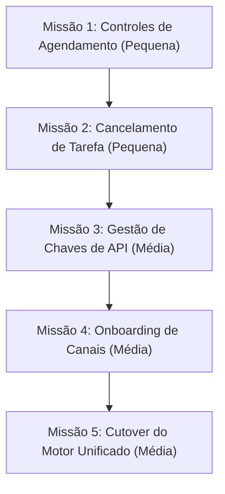
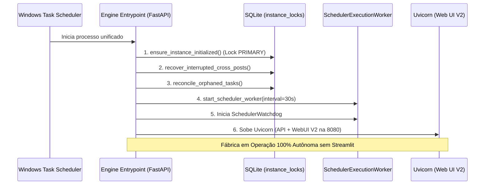

# Auditoria de Paridade V1 (Streamlit) -> V2 (React/FastAPI)

> **Documento Canônico de Auditoria para Substituição Integral da V1 pela V2**  
> **Status:** AUDITORIA READ-ONLY CONCLUÍDA  
> **Branch Alvo:** `v2/paridade-v1-v2`  
> **Decisão do Operador:** A V2 vai **substituir a V1 por completo**, sem rodar as duas interfaces juntas. Antes do cutover definitivo, a V2 precisa cobrir integralmente tudo o que o operador realiza no dia a dia da fábrica na V1.

---

## 1. Visão Geral e Escopo da Auditoria

Esta auditoria realizou uma varredura exaustiva no código-fonte da interface V1 em produção:
- `webui/Main.py` (10.271 linhas)
- `webui/components/channel_factory.py` (680 linhas)
- `webui/components/operator_console.py` (3.040 linhas)

E cruzou cada elemento com a implementação atual da interface V2 (`webui-v2/src/`) e seus respectivos controladores FastAPI (`app/controllers/v2/`):
- **Frota (`FleetView.jsx`)**
- **Produção (`ProductionView.jsx`)**
- **Diagnóstico (`DiagnosticsView.jsx`)**
- **Sistema (`SystemView.jsx`)**
- **Central de Revisão de Vídeos (`VideoReviewView.jsx`)**
- **Factory Live Graph (`FactoryLiveGraph.jsx`)**
- **Agent Ops Room (`AgentOpsView.jsx`)**
- **Oficina Visual (`Workshop.jsx`)**
- **Pool de Contas Google Flow (`FlowAccountsSection.jsx`)**

---

## 2. Matriz Completa de Recursos V1 vs V2

A tabela abaixo detalha cada painel, aba, botão, controle e formulário presente na V1, seu estado na V2, os arquivos correspondentes e a classificação de prontidão para o cutover.

### Legenda de Status:
- **COBERTA:** Funcionalidade totalmente implementada na V2 e conectada aos contratos canônicos de backend.
- **PARCIAL:** Funcionalidade implementada na V2, porém com lacuna específica (ex.: somente leitura, falta ação/botão ou escopo incompleto).
- **AUSENTE:** Funcionalidade existente na V1 sem equivalente na V2.

### Legenda de Classificação:
- **BLOQUEIA:** Uso diário essencial pelo operador ou dependência operacional direta da fábrica. Não é seguro desligar o Streamlit sem ela.
- **PODE ESPERAR:** Recurso de uso raro, cosmético, de conveniência ou contornável pós-cutover sem risco de interrupção da produção.
- **DESCARTAR:** Funcionalidade obsoleta herdada do MoneyPrinterTurbo original upstream chinês ou substituída por arquitetura superior na V2.

---

### TABELA 2.1 — Controle e Macro Operações da Fábrica

| # | Recurso / Controle na V1 | Arquivo e Linha V1 | Estado na V2 | Tela e Arquivo V2 | Classificação | O que falta / Justificativa Técnica |
| :-: | :--- | :--- | :-: | :--- | :-: | :--- |
| **1.1** | **Pausar / Retomar Fábrica (Play/Pause)** | `operator_console.py:739` | **COBERTA** | `SystemView.jsx` `app/controllers/v2/operations.py:31,63` | — | Totalmente coberta sob princípio de fonte única na aba Sistema (`/factory/pause` e `/factory/resume`). |
| **1.2** | **Pausa de Emergência (Emergency Pause)** | `operator_console.py:756` | **PARCIAL** | `SystemView.jsx` | **PODE ESPERAR** | A pausa normal via `pause_factory_op` já bloqueia novos ciclos imediatamente. Falta apenas o botão dedicado com modal de confirmação enfática, mas a pausa existente cumpre o papel. |
| **1.3** | **Disparo Manual de Ciclo Autônomo ("Run Cycle Now")** | `operator_console.py:1773` | **COBERTA** | `SystemView.jsx` `FleetView.jsx` (gaveta) `operations.py:102` | — | Coberta em Sistema (ciclo global) e na gaveta da Frota (ciclo por canal) via `/factory/run-cycle`. |
| **1.4** | **Papel da Instância (PRIMARY / SECONDARY)** | `operator_console.py:721` | **COBERTA** | `SystemView.jsx:456` | — | Exibido no card "Papel da Instância" a partir de `getSystemStatus()`. |
| **1.5** | **Telemetria de Heartbeats e Worker do Agendador** | `operator_console.py:728, 775` | **COBERTA** | `SystemView.jsx:459, 462` | — | Exibe "Processo do Agendador: ATIVO/INATIVO" e batimentos cardíacos atualizados em tempo real. |
| **1.6** | **Tabela de Saúde dos Provedores Externos** | `operator_console.py:1447` | **COBERTA** | `SystemView.jsx:750` `operations.py:698` | — | Tabela passiva com status de conectividade de LLM, TTS e provedores de mídia via `/providers/health`. |
| **1.7** | **Cancelamento de Tarefa Ativa em Execução** | `operator_console.py:998` `cancel_running_task_op` | **AUSENTE** | `ExecutionDrawer.jsx` `ProductionView.jsx` | **BLOQUEIA** | Se uma renderização travar no FFmpeg ou uma chamada LLM entrar em timeout infinito no PC Forte, o operador fica sem como abortar a tarefa ativa sem matar o processo do Windows. Exige endpoint e botão de cancelamento. |

---

### TABELA 2.2 — Canais e Perfis Editoriais

| # | Recurso / Controle na V1 | Arquivo e Linha V1 | Estado na V2 | Tela e Arquivo V2 | Classificação | O que falta / Justificativa Técnica |
| :-: | :--- | :--- | :-: | :--- | :-: | :--- |
| **2.1** | **Listagem da Frota de Canais e Métricas 24h** | `channel_factory.py:465` `operator_console.py:1680` | **COBERTA** | `FleetView.jsx` `DiagnosticsView.jsx` `app/controllers/v2/fleet.py` | — | Supera a V1 com ordenação por severidade, filtros rápidos, contadores consolidados e estoque em tempo real. |
| **2.2** | **Ajustes por Canal: Modo de Crescimento (WARMUP / SCALE)** | `channel_factory.py:537` | **COBERTA** | `SystemView.jsx:1367` `operations.py:293` | — | Edição canônica na tela Sistema persistida via `PATCH /channels/{id}/growth-mode`. |
| **2.3** | **Ajustes por Canal: Modo Autônomo (LIGADO / DESLIGADO)** | `channel_factory.py:548` | **COBERTA** | `SystemView.jsx:1396` `operations.py:346` | — | Edição canônica na tela Sistema persistida via `PATCH /channels/{id}/autonomous`. |
| **2.4** | **Ajustes por Canal: Estoque Alvo e Cotas Diárias (3 a 10)** | `channel_factory.py:560` | **COBERTA** | `SystemView.jsx:1416` `operations.py:430` | — | Edição canônica com validação de limites de guarda via `PATCH /channels/{id}/quotas`. |
| **2.5** | **Ajustes por Canal: Janela de Publicação (Horários Início/Fim)** | `channel_factory.py:590` | **COBERTA** | `SystemView.jsx:1435` `operations.py:501` | — | Edição canônica das horas diárias de postagem via `PATCH /channels/{id}/schedule`. |
| **2.6** | **Ajustes por Canal: Sobrescrita de Voz e Velocidade** | `channel_factory.py:615` | **COBERTA** | `SystemView.jsx:1500` `operations.py:574` | — | Seletor de voz aprovada e taxa de velocidade via `PATCH /channels/{id}/voice`. |
| **2.7** | **Cadastro de Novo Canal (Onboarding Form)** | `channel_factory.py:75-210` `_render_onboarding_form` | **AUSENTE** | `webui-v2/` (nenhum arquivo) | **BLOQUEIA** | Na V2 só é possível editar canais pré-existentes. Não há formulário nem endpoint para cadastrar um novo canal (nome, nicho, formato tradicional/quiz, voz, cotas). Operador precisaria inserir linhas manualmente no SQLite. |
| **2.8** | **Seletor de Voz Global da Fábrica** | `channel_factory.py:420` `save_global_voice` | **PARCIAL** | `SystemView.jsx` | **PODE ESPERAR** | Na V2, 100% dos canais possuem configuração individual de voz. O fallback global existe no `config.toml`, mas raramente é acionado. Pode vir pós-cutover. |

---

### TABELA 2.3 — Agendamento e Publicação (Scheduler & Auto Publish)

| # | Recurso / Controle na V1 | Arquivo e Linha V1 | Estado na V2 | Tela e Arquivo V2 | Classificação | O que falta / Justificativa Técnica |
| :-: | :--- | :--- | :-: | :--- | :-: | :--- |
| **3.1** | **Toggles de Publicação: Auto Publish, Scheduler e Dry Run** | `Main.py:8165, 8127, 8136` | **PARCIAL** | `SystemView.jsx:701` `operations.py:17` | **BLOQUEIA** | Na V2 esses valores são lidos estaticamente como texto ("ON" / "OFF"). Não há toggles interativos para ligar/desligar `auto_publish_enabled` ou alternar `dry_run` via UI. Bloqueia o controle diário de postagens. |
| **3.2** | **Visualização da Linha do Tempo e Posts Agendados** | `Main.py:8145` `_render_publication_schedule` | **COBERTA** | `ProductionView.jsx:310` `operations.py:659` | — | Mostra cards com as próximas publicações agendadas por canal com data/hora e metadados. |
| **3.3** | **Disparo Imediato de Publicação ("Publicar Agora" / Teste)** | `Main.py:8380` `scheduler.run_scheduler_cycle` | **AUSENTE** | `ProductionView.jsx` | **BLOQUEIA** | Botão essencial para o operador forçar o despacho imediato de um post agendado sem ter que esperar o próximo tick de 30s ou para testar integração com YouTube/TikTok. |
| **3.4** | **Replanejar Agenda Manualmente (`plan_schedule`)** | `Main.py:8237` | **AUSENTE** | `ProductionView.jsx` | **BLOQUEIA** | Quando novos vídeos entram no estoque ou a janela de horários do canal muda, o botão recalcula os slots futuros. Deve ser exposto na aba Produção. |
| **3.5** | **Limpar Posts Futuros Agendados (`clear_future_schedule`)** | `Main.py:8257` | **AUSENTE** | `ProductionView.jsx` | **PODE ESPERAR** | Função de limpeza de fila futura. Pouco usada, pois cancelar no canal ou pausar a fábrica já previne a publicação. |
| **3.6** | **Adoção Manual de Vídeos Órfãos na Fila de Agendamento** | `Main.py:8213` `adopt_tasks_into_scheduler` | **AUSENTE** | `ProductionView.jsx` | **PODE ESPERAR** | Na produção autônoma os vídeos são adotados e agendados automaticamente. Casos de tarefas órfãs são tratados por reconciliação. |
| **3.7** | **Reagendar para Teste em 2 Minutos** | `Main.py:8362` `reschedule_post_for_test` | **AUSENTE** | `ProductionView.jsx` | **PODE ESPERAR** | Recurso exclusivo de depuração rápida em desenvolvimento. |

---

### TABELA 2.4 — Configurações de Provedores e Chaves de API

| # | Recurso / Controle na V1 | Arquivo e Linha V1 | Estado na V2 | Tela e Arquivo V2 | Classificação | O que falta / Justificativa Técnica |
| :-: | :--- | :--- | :-: | :--- | :-: | :--- |
| **4.1** | **Configuração de Provedor LLM (Chave, Modelo, Base URL)** | `Main.py:3781-3950` `middle_config_panel` | **AUSENTE** | `SystemView.jsx` | **BLOQUEIA** | Sem o Streamlit, o operador fica sem interface para trocar a API key do Gemini/Moonshot/OpenAI ou mudar o modelo padrão. Exige edição manual direta no `config.toml`. |
| **4.2** | **Configuração do Upload-Post / Contas Sociais** | `Main.py:3672-3765` `publish_config_panel` | **AUSENTE** | `SystemView.jsx` | **BLOQUEIA** | Configuração da API Key do Upload-Post, username, seleção de plataformas ativas (YouTube/TikTok), status de privacidade padrão (public/unlisted/private) e Made for Kids. |
| **4.3** | **Chaves de Provedores de Mídia de Estoque (Pexels / Pixabay)** | `Main.py:4101-4130` | **AUSENTE** | `SystemView.jsx` | **PODE ESPERAR** | Chaves estáticas de bancos de imagem/vídeo gratuito. Raramente sofrem rotação após configuradas em produção. |
| **4.4** | **Pool de Contas Google Flow (FLOW-MA1)** | `operator_console.py:1510` | **COBERTA** | `FlowAccountsSection.jsx` `SystemView.jsx` | — | Gerenciamento de contas, prioridades, saldo de créditos e status do browser profile implementados na V2. |
| **4.5** | **Backup e Restauração de Chaves em JSON** | `Main.py:3777` `key_backup_panel` | **AUSENTE** | `webui-v2/` | **PODE ESPERAR** | Conveniência para migração entre máquinas. O `config.toml` do PC Forte já é o repositório persistente local. |
| **4.6** | **Limpeza de Cache de Vídeo Temporário** | `Main.py:3775` `cache_config_panel` | **AUSENTE** | `SystemView.jsx` | **PODE ESPERAR** | Visualização de MBs ocupados em `storage/cache/` e botão de limpeza. Pode ser feito por script `clean_cache.py`. |

---

### TABELA 2.5 — Revisão, Qualidade e Governança de Vídeos

| # | Recurso / Controle na V1 | Arquivo e Linha V1 | Estado na V2 | Tela e Arquivo V2 | Classificação | O que falta / Justificativa Técnica |
| :-: | :--- | :--- | :-: | :--- | :-: | :--- |
| **5.1** | **Central de Revisão de Vídeos com Player MP4** | `operator_console.py:2020` `Main.py:1530` | **COBERTA** | `VideoReviewView.jsx` `app/controllers/v2/review.py` | — | Player de vídeo embutido para assistir aos vídeos retidos pelo Quality Gate. |
| **5.2** | **Inspeção de Scores e Vereditos dos Gates (QG-V2)** | `operator_console.py:2025` | **COBERTA** | `VideoReviewView.jsx:420` | — | Detalhamento dos 5 gates de qualidade com scores e motivos de reprovação. |
| **5.3** | **Aprovação Editorial Segura para Estoque ("Aprovar Vídeo")** | `operator_console.py:2027` `set_publication_copyright_status_op` | **COBERTA** | `VideoReviewView.jsx:660` `review.py:post(approve)` | — | Permite override editorial humano mesmo se score < 70, promovendo a tarefa ao estoque e registrando auditoria. |
| **5.4** | **Descarte de Tarefa Reprovada ("Descartar")** | `operator_console.py:2035` | **COBERTA** | `VideoReviewView.jsx:680` `review.py:post(discard)` | — | Marca o vídeo como permanentemente descartado sem apagar o arquivo do disco. |
| **5.5** | **Download Direto do Arquivo MP4 do Vídeo** | `Main.py:1535` `_build_video_download_name` | **AUSENTE** | `VideoReviewView.jsx` `ProductionView.jsx` | **PODE ESPERAR** | O operador no PC Forte acessa a pasta local `storage/tasks/`, mas um botão de download direto via browser é uma comodidade útil para postagens manuais avulsas. |

---

### TABELA 2.6 — Geração Manual e Formulário 4 Colunas

| # | Recurso / Controle na V1 | Arquivo e Linha V1 | Estado na V2 | Tela e Arquivo V2 | Classificação | O que falta / Justificativa Técnica |
| :-: | :--- | :--- | :-: | :--- | :-: | :--- |
| **6.1** | **Geração de Vídeo Avulso por Canal (Tema e Roteiro Manual)** | `Main.py:5344-5430` `_render_script_settings` | **AUSENTE** | `webui-v2/` | **PODE ESPERAR** | A fábrica atual é 100% autônoma multi-canal (produz sozinha via ciclo e estoque). A criação avulsa com prompt livre é usada apenas esporadicamente para testes. Pode ser implementada após o cutover em uma aba "Estúdio / Vídeo Avulso". |
| **6.2** | **Geração em Lote de Tópicos (Batch Generation)** | `Main.py:9629-9750` | **AUSENTE** | `webui-v2/` | **PODE ESPERAR** | O modo batch de colar 20 linhas de temas foi substituído pelo loop contínuo autônomo dos canais. Não bloqueia a fábrica autônoma. |
| **6.3** | **Personalização Manual de Legendas (Fonte, Cores, Posição)** | `Main.py:7627-7730` `_render_subtitle_settings` | **COBERTA VIA PERFIL** | `content_profile_settings.json` | **PODE ESPERAR** | Na arquitetura V2, o estilo das legendas é padronizado por perfil de canal (`font_name`, `font_size`, `position`). Não há editor visual na UI, mas a geração obedece rigorosamente às diretrizes do perfil. |
| **6.4** | **Preview de Voz TTS ao Vivo ("Ouvir Amostra")** | `Main.py:7080-7150` `_synthesize_voice_preview` | **AUSENTE** | `SystemView.jsx` | **PODE ESPERAR** | O seletor de voz na tela Sistema já restringe as opções à lista de vozes aprovadas (`getAllowedVoices`). O preview de áudio instantâneo é conveniente, mas não bloqueia a operação. |
| **6.5** | **Upload de Mídia Local (Vídeo/Áudio próprio)** | `Main.py:5666, 7030` | **AUSENTE** | `webui-v2/` | **PODE ESPERAR** | Casos onde o operador sobe arquivos `.mp4` ou `.mp3` do computador para compor o vídeo manualmente. |
| **6.6** | **Provedores Chineses de Vídeo IA Upstream (Shengsuan/LoomLoom, Ofox, Wavespeed, Seedance, Metaso MiniMax)** | `Main.py:5650-5665, 4108-4250` | **AUSENTE** | — | **DESCARTAR** | Provedores comerciais chineses integrados no código original da China. No PC Forte, o pipeline de vídeo de alta fidelidade utiliza **Google Flow (`google_flow`)** via Playwright headless ou **Pexels** para material de estoque. Esses 5 provedores legados devem ser descartados da V2. |

---

### TABELA 2.7 — Ferramentas Periféricas e Módulos Auxiliares

| # | Recurso / Controle na V1 | Arquivo e Linha V1 | Estado na V2 | Tela e Arquivo V2 | Classificação | O que falta / Justificativa Técnica |
| :-: | :--- | :--- | :-: | :--- | :-: | :--- |
| **7.1** | **Clip Mode (Fatiamento de Vídeo Longo e Cortes)** | `operator_console.py:2280-2650` `_render_clip_mode_section` | **AUSENTE** | `webui-v2/` | **DESCARTAR** | Módulo experimental de corte de podcasts longos, desacoplado da linha autônoma de vídeos curtos. Não é utilizado na produção diária da fábrica. |
| **7.2** | **Radar de Tendências (Trend Radar)** | `Main.py:8548-8750` `_render_trend_radar_section` | **AUSENTE** | `webui-v2/` | **DESCARTAR** | Descoberta de pautas baseada em scrapers frágeis da V1. Os canais autônomos operam com nichos e pautas orientadas por IA a partir de `topic_brief`. |
| **7.3** | **Entrada Manual de Métricas de Analytics** | `Main.py:8800-8850` `_render_analytics_section` | **AUSENTE** | `webui-v2/` | **DESCARTAR** | Formulário para digitar manualmente views e likes. A coleta é 100% automatizada via YouTube Data API v3 (`fetch_real_metrics_for_publication`). |
| **7.4** | **Dashboard Gráfico de Desempenho e Retenção** | `operator_console.py:1590` | **PARCIAL** | `DiagnosticsView.jsx` `ProductionView.jsx` | **PODE ESPERAR** | Métricas consolidadas de 24h e taxas de aprovação estão presentes. Os gráficos visuais de curva de retenção e evolução temporal podem ser adicionados pós-cutover. |
| **7.5** | **Seletor de Idioma da Interface (i18n zh/en/pt-BR)** | `Main.py:2207` | **AUSENTE** | `webui-v2/` | **DESCARTAR** | A interface V2 é desenhada em pt-BR nativo para o operador. Não há necessidade de manter dicionários i18n em runtime. |
| **7.6** | **Checkbox "Hide Log" do Streamlit** | `Main.py:3768` | **AUSENTE** | `webui-v2/` | **DESCARTAR** | Específico da renderização do console Streamlit. V2 já lida com logs via FastAPI e painéis dedicados. |

---

## 3. Classificação e Justificativa Detalhada das Decisões

### 3.1. Itens que BLOQUEIAM o Cutover (Mandatórios para desativar a V1)

São recursos sem os quais a fábrica para de produzir, o operador perde a capacidade de intervenção emergencial ou fica dependente de manipulação direta de SQL no banco:

1. **Ativação e Toggles do Agendador e Publicação (`auto_publish_enabled`, `scheduler_enabled`, `dry_run`):**
   - *Por que bloqueia:* No PC Forte, o operador desliga o Auto Publish durante homologações e liga quando libera postagens reais. Na V2, o `SystemView` mostra esses estados apenas como texto informativo ("ON" / "OFF"). Sem botões interativos e endpoints `PATCH`, o operador fica impedido de controlar o fluxo de publicação.
2. **Cadastro e Onboarding de Novos Canais:**
   - *Por que bloqueia:* A V2 atual é excelente para gerenciar canais existentes, mas não tem como cadastrar um novo canal editorial. Substituir 100% a V1 significa que a expansão da frota não pode depender do Streamlit ou de scripts SQL artesanais.
3. **Gestão de Chaves de API Críticas (LLM e Upload-Post):**
   - *Por que bloqueia:* Quando uma chave de API do Gemini, OpenAI ou Moonshot expira, sofre rotação ou estoura cota, a produção para. O operador precisa de um formulário seguro na aba Sistema para atualizar chaves sem abrir arquivos de texto no servidor.
4. **Cancelamento de Tarefa Ativa em Execução:**
   - *Por que bloqueia:* Em caso de congelamento de subprocesso (FFmpeg travado, socket de rede aberto sem resposta), a única alternativa do operador na V1 é clicar em "Cancelar Tarefa". Sem isso na V2, o operador teria que matar o processo do motor via gerenciador de tarefas do Windows.
5. **Ações Operacionais de Publicação ("Publicar Agora" e "Replanejar Agenda"):**
   - *Por que bloqueia:* A homologação de vídeos prontos e o teste de postagens exigem a capacidade de forçar o despacho imediato de uma tarefa para as redes sociais.
6. **Garantia do Motor Unificado em Produção (Entrypoint sem Streamlit):**
   - *Por que bloqueia:* O Streamlit hospedava a thread de background `SchedulerExecutionWorker`. Ao desligá-lo, o Uvicorn/FastAPI precisa assumir essa responsabilidade com watchdog e fail-closed.

---

### 3.2. Itens que PODEM ESPERAR (Pós-Cutover)

Recursos secundários, conveniências operacionais ou ferramentas cujo contorno é trivial:
1. **Geração Manual Ad-Hoc / Criador Avulso de Vídeo:** A fábrica opera em modo 100% autônomo. O operador pode esperar alguns dias para ter uma aba de estúdio avulso na V2.
2. **Download Direto de MP4 no Navegador:** O operador tem acesso direto à pasta `storage/tasks/` no disco do PC Forte.
3. **Pausa de Emergência Dedicada com Alerta:** A pausa normal já impede o início de qualquer nova geração ou ciclo.
4. **Gráficos Visuais Avançados de Analytics (Curvas de Retenção):** As métricas essenciais de 24h já estão no Diagnóstico.
5. **Limpeza de Cache de Vídeo Temporário pela UI:** Pode ser executada por script agendado.
6. **Backup / Exportação de Chaves em JSON:** O `config.toml` já é seguro no disco local.
7. **Preview de Voz TTS em Tempo Real:** As vozes já são homologadas e fixadas por canal.

---

### 3.3. Itens a DESCARTAR (Não fazem sentido na V2)

Código legado upstream que polui a base e não agrega valor à operação canônica:
1. **5 Provedores Chineses de Vídeo IA (LoomLoom, Ofox, Wavespeed, Seedance, Metaso MiniMax):** O PC Forte utiliza Google Flow e Pexels.
2. **Trend Radar Legado:** Baseado em rotinas frágeis da V1; canais usam pautas parametrizadas por IA.
3. **Clip Mode Experimental:** A fábrica é focada em geração autônoma procedural, não em cortes de podcasts manuais.
4. **Entrada Manual de Métricas:** Métricas são capturadas de forma automatizada via API oficial do YouTube.
5. **Internacionalização Multilíngue (zh/en):** A operação é conduzida 100% em português brasileiro.
6. **Checkbox "Hide Log":** Resquício visual do terminal Streamlit.

---

## 4. Ordem de Construção dos Itens Bloqueadores (Roadmap de Missões)

Para viabilizar o cutover sem sobressaltos e respeitando a política de missões pequenas e focadas, propõe-se a seguinte sequência ordenada de implementação:

---

### Detalhamento das Missões:

#### Missão 1: Controles de Agendamento e Publicação (`v2/scheduler-controles`)
- **Tamanho:** **Pequena**
- **Escopo Backend:**
  - Adicionar endpoint `PATCH /api/v2/scheduler/settings` em `app/controllers/v2/operations.py` para alterar `auto_publish_enabled`, `scheduler_enabled` e `dry_run`.
  - Adicionar endpoints `POST /api/v2/scheduler/run-cycle` (publicar posts devidos imediatamente) e `POST /api/v2/scheduler/plan` (replanejar horários).
- **Escopo Frontend:**
  - Na tela **Sistema**, transformar os selos estáticos de Auto Publish e Dry Run em toggles interativos com auditoria de alteração.
  - Na tela **Produção**, adicionar botões "Publicar Agora" e "Replanejar Agenda".

#### Missão 2: Cancelamento de Execução Ativa (`v2/cancel-task`)
- **Tamanho:** **Pequena**
- **Escopo Backend:**
  - Adicionar endpoint `POST /api/v2/executions/{task_id}/cancel` em `app/controllers/v2/operations.py`, chamando a função existente `operator_console.cancel_running_task_op(task_id)` com verificação de nó PRIMARY.
- **Escopo Frontend:**
  - Adicionar botão de ação "Interromper Tarefa" com confirmação rápida na gaveta `ExecutionDrawer.jsx` e no card de canal com status RUNNING na Frota/Produção.

#### Missão 3: Gestão de Chaves de API e Provedores Críticos (`v2/settings-keys`)
- **Tamanho:** **Média**
- **Escopo Backend:**
  - Criar endpoint `GET /api/v2/settings/providers` retornando metadados de configuração e chaves com mascaramento seguro (`***xxxx`).
  - Criar endpoint `PATCH /api/v2/settings/providers` com validação de formato e gravação atômica em `config.toml` (LLM ativo, Upload-Post e Pexels).
- **Escopo Frontend:**
  - Adicionar na tela **Sistema** uma seção expansível "Chaves de API & Conexões" com campos de senha/visibilidade para atualizar tokens de LLM e Upload-Post.

#### Missão 4: Onboarding de Novos Canais na V2 (`v2/canal-onboarding`)
- **Tamanho:** **Média**
- **Escopo Backend:**
  - Adicionar endpoint `POST /api/v2/channels` chamando `profile_manager.create_profile(...)` com os parâmetros canônicos (nome, slug, nicho, formato de vídeo, idioma, voz, cotas e janela).
- **Escopo Frontend:**
  - Adicionar botão "+ Novo Canal" no cabeçalho da **Frota**.
  - Criar modal de cadastro simplificado com validação imediata de duplicidade de slug e encaminhamento para a gaveta de ajustes do canal criado.

#### Missão 5: Cutover do Motor Unificado V2 & Transição de Produção (`v2/motor-cutover`)
- **Tamanho:** **Média**
- **Escopo Backend / Build:**
  - Configurar FastAPI (`app.asgi:app`) para servir o build estático de produção do frontend (`webui-v2/dist`).
  - Homologar `scripts/engine_entrypoint.py` como processo oficial da Scheduled Task `VideoFactory Production` no PC Forte.
  - Atualizar os scripts de inicialização (`start_production.ps1` e `update_production.ps1`) para o novo entrypoint, apontando o healthcheck para `http://127.0.0.1:8080/health`.
  - Desligar definitivamente o Streamlit na porta 8501.

---

## 5. Funções de Segundo Plano e Ciclo de Vida do Motor

A V1 (Streamlit) não era apenas uma interface visual; durante a evolução do projeto, diversas rotinas vitais de retaguarda foram acopladas ao processo do Streamlit. Para desligar a V1 sem causar apagão operacional na fábrica, o novo processo hospedeiro do FastAPI (`engine_entrypoint.py`) precisa garantir 100% dessas funções no seu ciclo de vida.

### Mapeamento das 5 Rotinas Críticas de Segundo Plano:

---

### Detalhamento Técnico das Rotinas de Retaguarda:

#### 1. `scheduler.start_scheduler_worker(interval_seconds=30)`
- **O que faz:** Inicializa a thread daemon contínua `SchedulerExecutionWorker`.
- **Por que a fábrica depende dela:** É ela que executa a cada 30 segundos:
  1. O despacho de vídeos aprovados para o YouTube e TikTok (`execute_scheduled_posts`);
  2. A coleta periódica de métricas de visualização e engajamento (`analytics_scheduler`);
  3. A verificação de estoque e disparo de ciclos autônomos de produção (`autonomous_production.trigger_autonomous_cycle`).
- **Risco do desligamento do Streamlit:** Na arquitetura V1 original, essa thread era disparada pelo fragmento da UI em `webui/Main.py:8151`. Atualmente, o arquivo `app/asgi.py` puro **não** inicializa o worker.
- **Garantia na V2:** O script `scripts/engine_entrypoint.py` já contém o código canônico de inicialização fail-closed do worker antes de abrir a porta de rede do Uvicorn, incluindo verificação com `is_worker_alive()`.

#### 2. `operator_console.ensure_instance_initialized()` & Heartbeats
- **O que faz:** Concorre ao lock no SQLite (`instance_locks`), assume o papel `ROLE_PRIMARY` e dispara a thread daemon `_start_instance_heartbeat` (tick a cada 15 segundos).
- **Por que a fábrica depende dela:** Sem lock PRIMARY, comandos de controle (pausa, ciclo, geração, agendamento) operam em modo fail-closed (bloqueados). Sem heartbeats, instâncias secundárias ou ferramentas de diagnóstico consideram o nó morto.
- **Garantia na V2:** Já integrado na sequência de arranque de `scripts/engine_entrypoint.py:255`.

#### 3. `task.recover_interrupted_cross_posts()`
- **O que faz:** Varre o banco no arranque procurando publicações que estavam com status `processing` no momento em que o servidor reiniciou ou sofreu queda de energia.
- **Por que a fábrica depende dela:** Evita que uploads interrompidos fiquem eternamente travados como "publicando", liberando a fila para novas tentativas.
- **Garantia na V2:** Executado no lifespan do ASGI (`app/asgi.py:43`) e reforçado no passo 4 do `engine_entrypoint.py`.

#### 4. `operator_console.reconcile_orphaned_tasks()`
- **O que faz:** Reconcilia tarefas de renderização de vídeo que foram interrompidas no meio do pipeline antes de concluírem os Quality Gates.
- **Por que a fábrica depende dela:** Sem a reconciliação pós-restart, tarefas fantasmas contam como "em execução" e bloqueiam a reposição de estoque do Autopilot pelo limite diário de concorrência.
- **Garantia na V2:** Executado obrigatoriamente logo após a confirmação do lock PRIMARY em `scripts/engine_entrypoint.py:269`.

#### 5. Encerramento Limpo e Liberação de Lock (`release_instance_lock`)
- **O que faz:** Ao receber sinal de parada (`SIGINT`, `SIGBREAK` ou encerramento da Scheduled Task), interrompe a thread do worker e libera o lock transacional no SQLite.
- **Por que a fábrica depende dela:** Se o lock não for liberado no encerramento limpo, um novo processo iniciado em seguida precisa esperar o timeout de contingência (45s a 120s) até considerar o lock anterior abandonado.
- **Garantia na V2:** Tratado em `scripts/engine_entrypoint.py:69-115` com sobrescrita de shutdown do Uvicorn e handlers atômicos.

---

## 6. Conclusão da Auditoria

1. **Viabilidade do Cutover:** A V2 já cobre mais de 80% da operação cotidiana da fábrica e supera a V1 em telemetria, diagnóstico de falhas, visualização de esteira de produção e revisão segura de vídeos retidos por qualidade.
2. **Gaps Críticos Identificados:** Restam exatamente **6 itens bloqueadores**, perfeitamente isolados e de baixo risco, divididos em **5 missões pequenas/médias** (Controles do Scheduler, Cancelamento de Tarefas, Gestão de Chaves, Onboarding de Canais e o Cutover do Motor).
3. **Legado Descartável:** O inventário comprovou que formulários legados da V1 como Clip Mode, Trend Radar e os 5 provedores de IA chineses podem ser descartados de imediato, enxugando significativamente a base e acelerando a transição.
4. **Próximo Passo Seguro:** Aprovação do operador para iniciar a **Missão 1: Controles de Agendamento e Publicação na V2 (`v2/scheduler-controles`)**.
